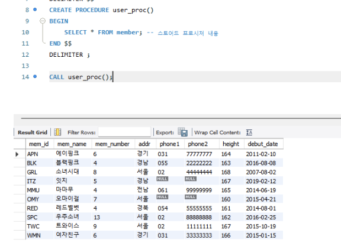
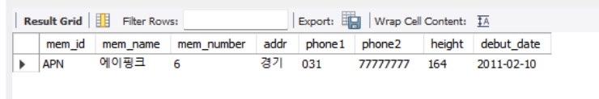
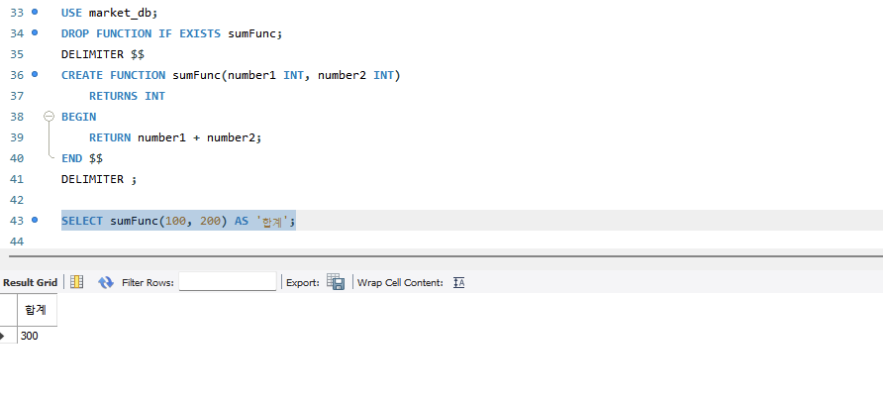
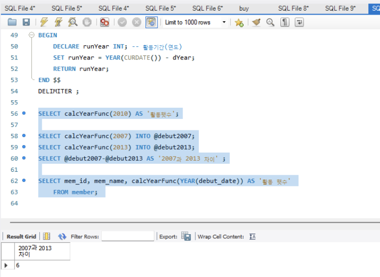
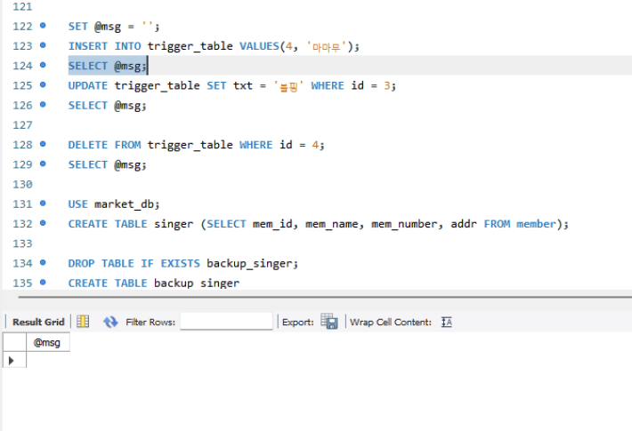
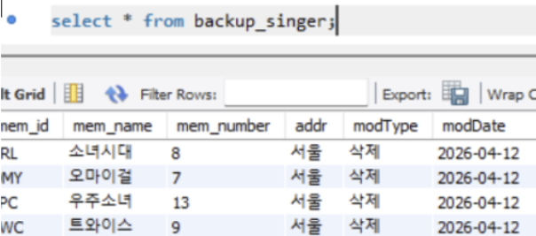

# SQL_ADVANCED 6주차 정규 과제 

📌SQL_ADVANCED 정규과제는 매주 정해진 분량의 『*혼자 공부하는 SQL*』 을 읽고 학습하는 것입니다. 이번주는 아래의 **SQL_ADVANCED_6th_TIL**에 나열된 분량을 읽고 공부하시면 됩니다.

아래의 문제를 풀어보며 학습 내용을 점검하세요. 문제를 해결하는 과정에서 개념을 스스로 정리하고, 필요한 경우 제시된 강의를 참고하여 보완하는 것이 좋습니다.

<!-- 강의 링크는 아래와 같습니다.
https://www.youtube.com/watch?v=cw1wGN0ZdFA&list=PLVsNizTWUw7GCfy5RH27cQL5MeKYnl8Pm&index=19
https://www.youtube.com/watch?v=bMQ_dAoaMzA&list=PLVsNizTWUw7GCfy5RH27cQL5MeKYnl8Pm&index=20
https://www.youtube.com/watch?v=bggWVsBmKag&list=PLVsNizTWUw7GCfy5RH27cQL5MeKYnl8Pm&index=21
-->

**교재 실습 예제 파일은 08_SQL_ADVANCED_Template 레포지토리의 src 폴더에 업로드되어 있습니다. market_db 파일도 해당 폴더에 함께 포함되어 있으니 참고하시기 바랍니다.**

**👀(수행 인증샷은 필수입니다.)** 

## SQL_ADVANCED_6th_TIL

### 7장 스토어드 프로시저
#### 01. 스토어드 프로시저 사용 방법
#### 02. 스토어드 함수와 커서
#### 03. 자동 실행되는 트리거 

## Study Schedule

| 주차  | 공부 범위     | 완료 여부 |
| ----- | ------------- | --------- |
| 1주차 | p.24~99    | ✅         |
| 2주차 | p.102~155   | ✅         |
| 3주차 | p.158~213  | ✅         |
| 4주차 | p.216~271 | ✅         |
| 5주차 | p.274~327 | ✅         |
| 6주차 | p.330~369 | ✅         |
| 7주차 | p.372~407 | 🍽️         |

 

<!-- 여기까진 그대로 둬 주세요-->

---

# 1️⃣ 학습 내용 정리

## 1. 스토어드 프로시저 사용 방법 

- 스토어드 프로시저 (Stored Procedure) 기본 개념
MySQL에서 제공하는 프로그래밍 기능임.
자주 쓰는 복잡한 쿼리들을 하나로 묶어두고, 필요할 때마다 커피 자판기 버튼 누르듯 쉽게 호출해서 쓰는 방식임.
만들 때는 CREATE PROCEDURE (자판기 만들기), 실행할 때는 CALL (커피 뽑기) 문을 사용함.

- 제어문 활용 (IF & WHILE)
파이썬이나 C언어처럼 IF ~ ELSE (조건문)나 WHILE (반복문)을 똑같이 쓸 수 있음.
DECLARE로 변수를 선언하고, SET이나 SELECT ... INTO 구문을 써서 변수에 값을 집어넣음.

- 동적 SQL (Dynamic SQL)
고정된 쿼리가 아니라, 쿼리문을 문자열 조립하듯 실시간으로 다이나믹하게 만들어서 실행하는 기법임.
작동 순서: PREPARE (쿼리 준비) -> EXECUTE (실행) -> DEALLOCATE PREPARE (다 쓴 쿼리 메모리 해제)

<!-- 이번 챕터에서는 확인문제를 실습 인증으로 대체하여 진행합니다. 제시된 실습을 흐름에 맞게 진행한 후, 실습 과정이 보일 수 있도록 인증 사진을 2장 이상 제출해 주세요. -->

## 2. 스토어드 함수와 커서 

- 스토어드 함수 기본
MySQL에서 기본 제공하는 함수 외에 사용자가 직접 만들어서 쓰는 함수임.
프로시저와 달리 RETURNS로 반환할 데이터 형식을 먼저 지정하고, 본문 안에서 RETURN으로 값을 반환함.
매개변수는 전부 값만 들어오는 입력용이라 굳이 IN을 붙이지 않음.
실행할 때 CALL을 쓰지 않고 SELECT 문 안에서 일반 함수처럼 호출해서 사용함.

- 커서 (Cursor) 개념과 작동 순서
테이블의 데이터를 한꺼번에 처리하지 않고 한 행씩 차례대로 접근해서 처리하는 기능임.
작동 순서: 사용할 변수 준비 -> 커서 선언 (SELECT문) -> 반복 조건 선언 (데이터 끝에 다다르면 어떻게 할지) -> 커서 열기 -> 커서 끝까지 한 행씩 반복 (LOOP)
무한 반복을 막기 위해 더 이상 읽을 데이터(행)가 없으면 변수 상태를 바꾸고 루프를 빠져나가는(LEAVE) 설정이 필수임.

## 3. 자동 실행되는 트리거 

- 트리거 (Trigger) 기본 개념
테이블에 어떤 이벤트(INSERT, UPDATE, DELETE)가 발생하면 총의 방아쇠를 당기듯 자동으로 실행되는 코드임.
사용자가 깜빡하고 추가 작업을 누락하는 실수를 막아주며, 데이터에 오류가 생기지 않도록(데이터 무결성) 지켜줌.
가장 대표적인 용도는 데이터가 삭제(DELETE)되거나 수정될 때, 기존 데이터를 백업 테이블에 자동으로 저장해 두는 것임.

- 작동 시점
AFTER DELETE: 말 그대로 DELETE 문이 발생한 '후'에 트리거를 작동하라는 의미임.

- 임시 시스템 테이블 (NEW와 OLD)
트리거 작동 시 MySQL이 알아서 생성하고 관리하는 임시 보관소임. 사용자가 직접 만들 필요 없음.
NEW 테이블: 새로 들어올 값(INSERT, UPDATE 시)이 실제 테이블에 들어가기 전에 잠깐 머무는 곳임.
OLD 테이블: 지워지거나 변경될 예전 값(DELETE, UPDATE 시)이 잠깐 머무는 곳임. (이 덕분에 데이터가 삭제된 후에도 OLD.열이름 형식으로 예전 값에 접근해서 백업할 수 있음)

<!-- 이번 챕터에서는 확인문제를 실습 인증으로 대체하여 진행합니다. 제시된 실습을 흐름에 맞게 진행한 후, 실습 과정이 보일 수 있도록 인증 사진을 2장 이상 제출해 주세요. -->

---s

### 🎉 수고하셨습니다.

